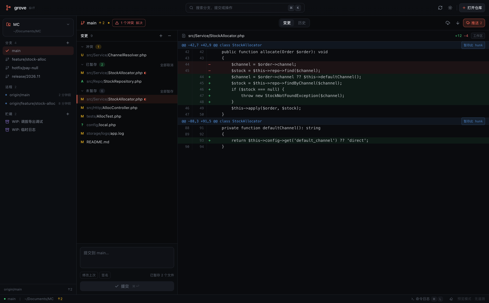
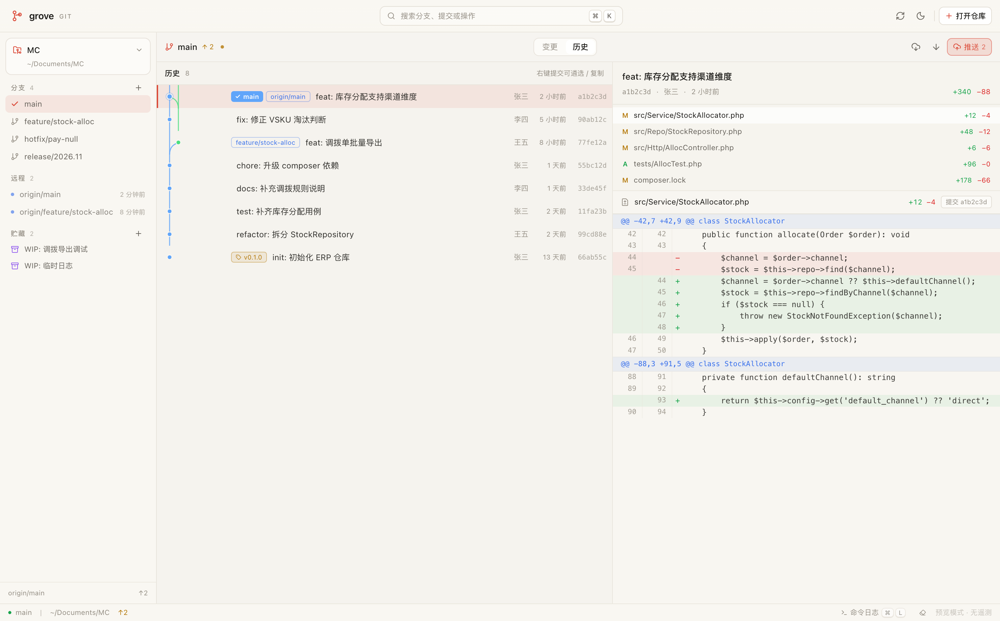
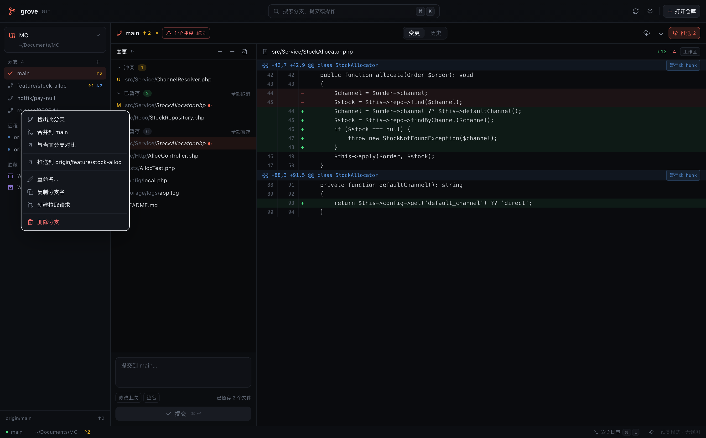
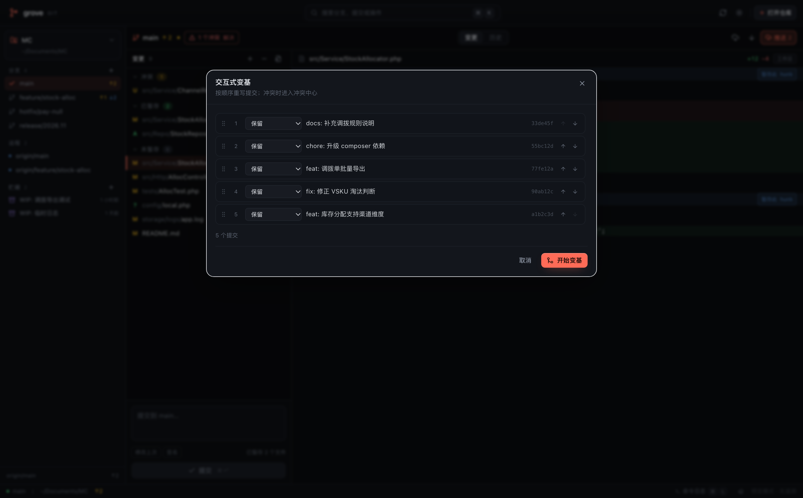
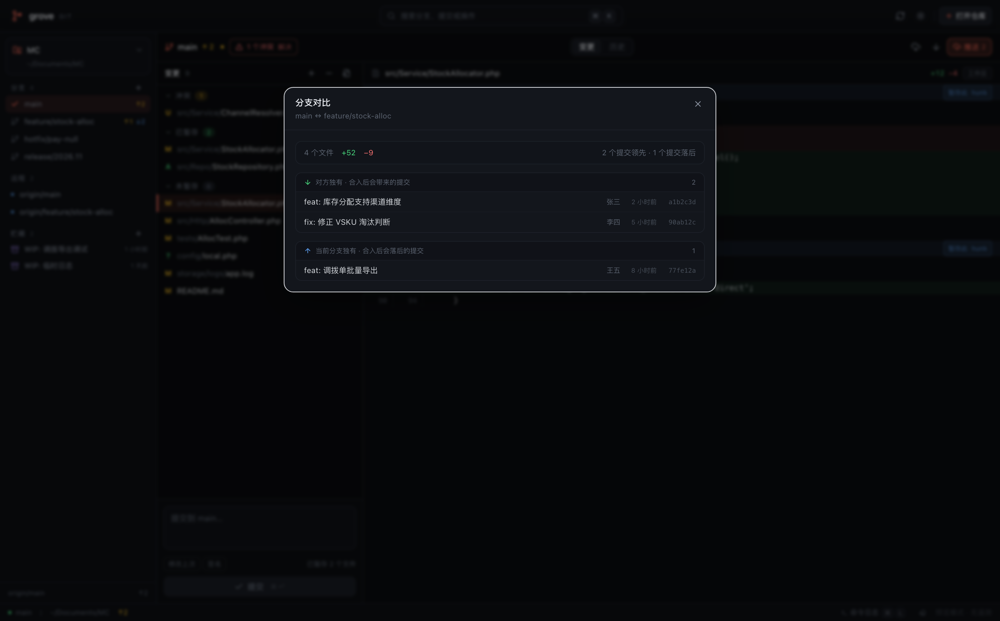
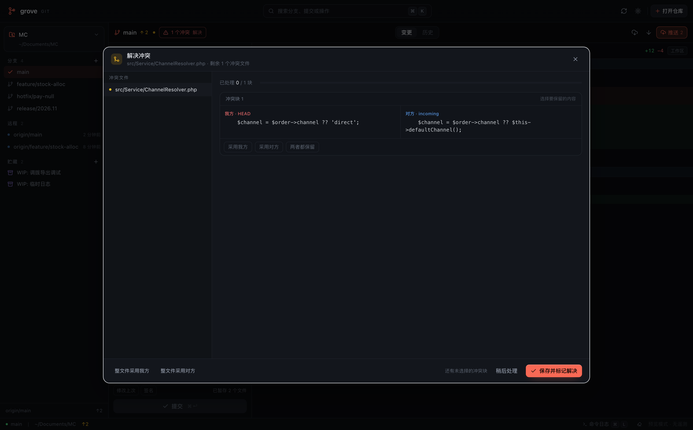
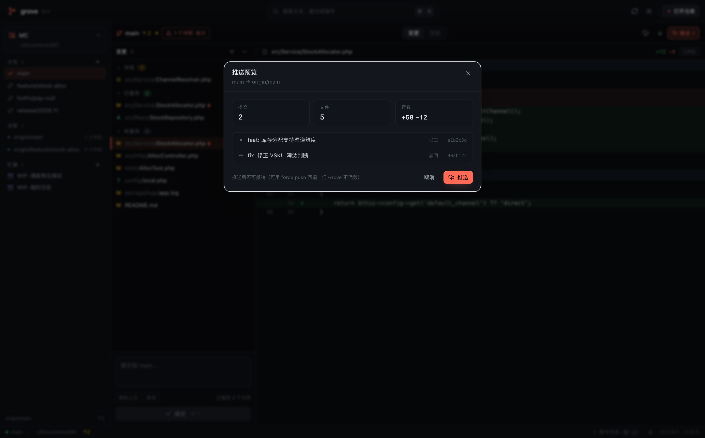

# Grove（暂定名）

> 快、稳、好看的 macOS Git 客户端。
> **状态：v0.1 可运行骨架** · Tauri 2 + Rust 内核 + React 19 + Tailwind。



## 现在能做什么

| 能力 | 说明 |
|------|------|
| 打开仓库 | 文件夹选择、最近仓库、无提交仓库也能打开；**多仓库标签页**（⌘⇧[ / ⌘⇧] 切换，脏状态圆点，重启恢复标签组）；三栏宽度可拖拽并记忆 |
| 变更列表 | 已暂存 / 未暂存 / 冲突三区；文件级暂存、取消暂存、撤销改动（未跟踪文件进废纸篓） |
| Diff | 工作区 / 暂存区 / 指定提交三种来源；行号、增删统计、hunk 吸顶 |
| Hunk 级暂存 | 在 diff 里单独暂存 / 取消暂存某一个 hunk（`git apply --cached` 双向） |
| 行级暂存 | 勾选 diff 里具体的 +/− 行，只暂存这几行（同一 hunk 内） |
| 提交 | 提交信息、`--amend`、`-S` 签名、⌘↩ 提交；只提交暂存区；可撤销上次提交（soft reset） |
| 历史 | 提交图（lane 布局）、ref 徽标、提交详情与文件列表；**按分支 / 作者筛选**、简化图；**虚拟滚动 + 滚动到底自动加载更多**；右键可回滚提交 |
| Blame | diff 面板顶部「差异 / Blame」切换，逐行显示提交、作者、时间 |
| 冲突中心 | 逐块采用我方/对方/两者；整文件采用；保存即 `git add`；进度与剩余文件 |
| 推送预览 | 待推送提交、文件数、增删行数、首次推送自动设上游提示；**保护分支**（默认 main/master，可配置）需显式确认 |
| 交互式变基 | 拖拽或按钮调整顺序、squash/fixup/drop/reword，冲突时进入冲突中心 |
| 撤销 | 顶部「↺」按钮 + 操作历史面板 + ⌘⇧Z；journal + `refs/grove/undo/*`，覆盖提交/删分支/删贮藏/合并/变基/遴选 |
| 本地私有文件 | 默认 `*_test.php` 不提交；通配符规则、行内「本地」徽标、全部暂存自动跳过、提交前二次拦截 |
| 分支 | 按字母排序；`feature/*` 等前缀自动折叠成树；侧栏搜索分支；远程分支全量展示；切换前二次确认（分支/远程/贮藏/工作树，状态记忆）；本地/远程列表、切换、新建、删除；**右键菜单**：合并到当前、推送、跟踪远程、对比、重命名、复制、创建 PR；每行实时显示 ↑ahead / ↓behind |
| 遴选（cherry-pick） | 单选或 ⌘ 多选，**支持「只遴选到工作区、不自动提交」（`-n`）** |
| 贮藏（stash） | 创建（`--keep-index`、`-u`）；点击预览文件与 diff；右键应用/弹出/删除 |
| 工作树（worktree） | 列出、创建（新分支或检出已有）、移除；点一下用新标签打开 |
| 同步 | fetch / pull / push（无上游时自动 `-u origin HEAD`） |
| 命令日志 | 每条 git 命令、耗时、退出码、输出，可展开复制 |
| 命令面板 | ⌘K 搜索分支、视图、同步、贮藏等操作 |
| 主题 | 暗色 / 浅色，跟随 rill 的暖炭黑 + 橙红设计体系；自绘下拉、菜单、弹窗统一风格 |
| 窗口 | 标题栏、标签栏、仓库头、列表头、状态栏按住即可拖动窗口（原生 startDragging）；分割线拖动调整栏宽 |

历史视图（浅色主题）：



## 尚未实现（接下来）

- 子模块、PR 列表
- PR 列表与审查（目前只打开浏览器创建页）
- `reset --hard` 的撤销（工作区改动无法恢复，目前只回滚历史）
- reword 不能与 squash/fixup 同时使用（编辑器调用顺序无法区分）

分支右键菜单：



交互式变基：



分支对比：



冲突中心：



推送预览：



## 安装包

`release/Grove_0.1.0_arm64.dmg`（Apple Silicon，ad-hoc 签名，首次打开需右键 → 打开）。

## 从源码运行

前置：Rust（1.80+）、Node 20+、pnpm、系统 git（2.23+，推荐 2.35+）。

```bash
cd app
pnpm install
pnpm app:dev          # 开发模式，自动启动 Vite + Tauri
```

其他命令：

```bash
pnpm build            # 前端类型检查 + 构建
cargo test -p grove-core        # 内核单元/集成测试（在 grove/ 根目录）
cargo build -p grove            # 编译桌面端
pnpm tauri build                # 打包 Grove.app（release）
```

调试时可用 `GROVE_REPO=/path/to/repo pnpm app:dev` 直接打开指定仓库（CLI 参数的雏形）。

## 目录结构

```
grove/
├── core/                 # Rust 内核，无 Tauri 依赖，可单独测试/复用
│   ├── src/git.rs        # git 命令封装、status/log/diff 解析、写操作
│   ├── src/graph.rs      # 提交图 lane 布局
│   ├── src/model.rs      # 与前端共享的数据结构
│   └── tests/flow.rs     # 真实仓库集成测试（提交/遴选/贮藏/图）
├── app/                  # Tauri 2 桌面应用
│   ├── src/              # React 19 + Tailwind 前端
│   └── src-tauri/        # 命令层、窗口配置、权限
└── docs/                 # 产品、视觉、架构、路线图设计文档
```

## 设计文档

| 文档 | 内容 |
|------|------|
| [01 市场与痛点分析](docs/01-市场与痛点分析.md) | 竞品全景、六类根因、"难用"到底难在哪 |
| [02 产品设计](docs/02-产品设计.md) | 场景剧本、功能地图、差异点、信息架构 |
| [03 视觉与交互规范](docs/03-视觉与交互规范.md) | 设计令牌、提交图、Diff、动效 |
| [04 技术架构](docs/04-技术架构.md) | 选型、分层、性能预算、关键模块 |
| [05 路线图与验收](docs/05-路线图与验收.md) | 里程碑与 DoD |
| [06 暂存区与操作语义](docs/06-暂存区与操作语义.md) | 三棵树模型、提交边界、遴选、贮藏、命令映射 |

## 已知限制

- 历史列表每页 250 条，滚动到底自动追加（虚拟滚动，已加载的会保留）。
- 大 diff 未做分片渲染，超大文件会慢。
- 未配置签名/公证，当前仅开发模式运行（`pnpm app:dev`）。
- 交互式 rebase 尚未实现；合并/变基/遴选进行中时，顶部横幅可继续或中止。
- 命令面板中的"遴选"需要先在历史里选中提交；批量操作入口在历史列表底部浮条。

## 快捷键

| 快捷键 | 动作 |
|--------|------|
| `⌘K` | 命令面板 |
| `⌘O` | 打开仓库 |
| `⌘R` | 刷新 |
| `⌘1` / `⌘2` | 变更 / 历史 |
| `⌘L` | 命令日志 |
| `空格` | 暂存 / 取消暂存当前文件 |
| `⌘↩` | 提交 |
| 悬停 hunk 头 | 单独暂存 / 取消暂存该 hunk |
| `⌘⇧Z` | 撤销上一步操作 |
| 右键分支 | 分支操作菜单 |
