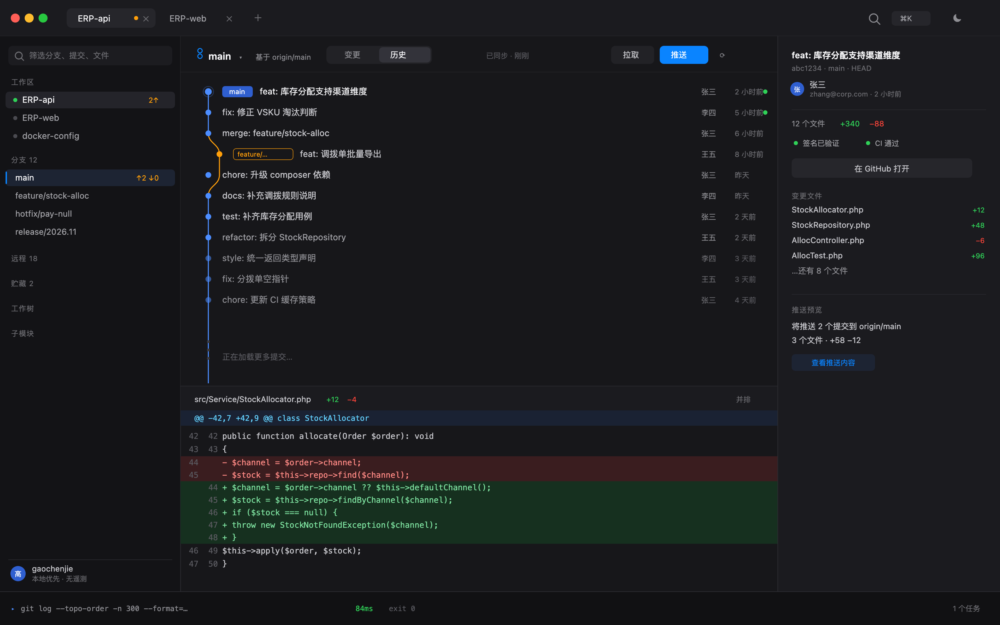

# 03 视觉与交互规范

> 目标：让工具"安静"，让用户"专注"。
> 关键词：**克制、精确、有生命**。像一台好的机械键盘——存在感低，反馈明确。

---

## 1. 设计语言

| 关键词 | 含义 | 反例 |
|--------|------|------|
| 克制 | 界面不抢内容；颜色只用于语义（增/删/冲突/状态） | 满屏彩色图标、渐变按钮 |
| 精确 | 等宽对齐、像素级分割线、数字用表格数字 | 参差不齐的元信息、模糊的分隔 |
| 有生命 | 图与列表的变化有连续感（lane 平滑延伸） | 每次刷新闪一下、整块重绘 |
| 原生 | 遵循 macOS 的材质、控件、菜单、快捷键习惯 | 自绘假窗口、Web 风格滚动条 |
| 暗色优先 | 暗色是主设计稿，亮色是推导 | 亮色好看、暗色发灰 |

---



> 样张为设计稿，非最终实现。SVG 源文件：`mockup-main-dark.svg`。

## 2. 窗口与布局

### 2.1 窗口结构

- 单窗口多标签；标签栏与工具栏合一（macOS 统一标题栏），`NSWindow` 全尺寸内容视图。
- 侧栏使用 `NSVisualEffectView`（sidebar 材质），随桌面壁纸透出，暗色下保留 8% 通透。
- 侧栏可拖拽调宽（200–360px），双击分隔线回到默认 260px。
- 右侧检查器 320px，可 ⌥⌘I 折叠。
- 底部抽屉高度 120px（可拖到 40px 收起），仅显示命令日志/任务。

### 2.2 栅格

- 基础单位 4pt；常用间距 4 / 8 / 12 / 16 / 24 / 32。
- 内容区左右留白 16pt，列表行内边距 8pt 12pt。
- 分割线 1px（Retina 0.5pt 物理像素），颜色 `separator`。
- 圆角：控件 6、面板 10、浮层 14、徽标 999。

### 2.3 密度

两档：**舒适**（默认，行高 28）、**紧凑**（行高 22，字号 -1）。历史列表与文件列表各自记忆密度。

---

## 3. 颜色系统（Design Tokens）

语义命名，禁止在组件里写死色值。基于 `Color` 资源 + 动态亮暗。

### 3.1 基础色

| Token | Light | Dark | 用途 |
|-------|-------|------|------|
| `bg.base` | `#FFFFFF` | `#17171A` | 内容底色 |
| `bg.raised` | `#F7F7F8` | `#1F1F23` | 卡片、检查器 |
| `bg.sunken` | `#F0F0F2` | `#111113` | 输入框凹槽、代码区 |
| `bg.sidebar` | 材质 | 材质 | 侧栏 |
| `text.primary` | `#1D1D1F` | `#F5F5F7` | 主文本 |
| `text.secondary` | `#6E6E73` | `#A1A1A6` | 元信息 |
| `text.tertiary` | `#8E8E93` | `#6E6E73` | 占位、禁用 |
| `border.subtle` | `rgba(0,0,0,.06)` | `rgba(255,255,255,.08)` | 分割线 |
| `border.strong` | `rgba(0,0,0,.12)` | `rgba(255,255,255,.14)` | 输入框、选中框 |
| `accent` | 系统强调色 | 同左 | 主按钮、选中、焦点环 |

### 3.2 语义色

| Token | Light | Dark | 语义 |
|-------|-------|------|------|
| `diff.add.bg` | `rgba(52,199,89,.12)` | `rgba(48,209,88,.14)` | 新增行底 |
| `diff.add.word` | `rgba(52,199,89,.28)` | `rgba(48,209,88,.32)` | 词级新增 |
| `diff.del.bg` | `rgba(255,59,48,.10)` | `rgba(255,69,58,.13)` | 删除行底 |
| `diff.del.word` | `rgba(255,59,48,.26)` | `rgba(255,69,58,.30)` | 词级删除 |
| `diff.hunk.bg` | `#EEF3FF` | `#1A2233` | hunk 头 |
| `diff.conflict.bg` | `rgba(255,159,10,.14)` | `rgba(255,159,10,.16)` | 冲突块 |
| `state.ok` | `#30D158` | `#30D158` | 干净、已解决 |
| `state.warn` | `#FF9F0A` | `#FF9F0A` | 中间态、ahead/behind |
| `state.danger` | `#FF453A` | `#FF453A` | 冲突、破坏性 |
| `state.info` | `#64D2FF` | `#64D2FF` | 提示 |

**约束**：语义色永不用于装饰。全屏彩色面积不得超过 15%。

### 3.3 提交图色板（8 色，亮暗通用，色盲可辨）

```
#4C8DFF 蓝   #FF9F0A 橙   #30D158 绿   #BF5AF2 紫
#FF375F 红   #64D2FF 青   #FFD60A 黄   #AC8E68 棕
```

lane 颜色按"分支首次出现的顺序"分配并**稳定不变**（同分支在整个会话中同色），避免刷新后颜色乱跳。

---

## 4. 字体与排版

| 用途 | 字体 | 字号/行高 | 备注 |
|------|------|-----------|------|
| UI 正文 | SF Pro Text | 13 / 18 | 系统默认 |
| 标题/仓库名 | SF Pro Display Semibold | 15 / 20 | |
| 元信息 | SF Pro Text | 11 / 14 | secondary 色 |
| 代码 / diff | SF Mono（可换 JetBrains Mono） | 12 / 18.5 | 行高 1.55，必须等宽 |
| 数字/统计 | SF Pro Text | 12 | `font-variant-numeric: tabular-nums` |
| 命令行 | SF Mono | 11.5 / 16 | 日志抽屉 |

**规则**

- 所有数值列（ahead/behind、行数、耗时）右对齐 + 表格数字，保证扫读。
- 提交信息单行截断用省略号，悬停显示全文；不在列表里换行导致行高不一。
- 时间一律相对（2 小时前 / 昨天 / 3 天前），悬停 tooltip 显示绝对时间与 ISO。

---

## 5. 提交图（Graph）视觉规则

这是"好看"的主战场，必须像艺术品一样精确。

### 5.1 几何

- lane 间距 14px；节点圆 8px（选中 10px + 2px 光环）；线宽 1.5px（Retina 0.75）。
- 曲线用三次贝塞尔：`C (x1, y1+Δ/2) (x2, y2-Δ/2) (x2, y2)`，避免折线。
- 合并边从节点右侧引出，向目标 lane 平滑收拢；分叉边对称处理。
- 行高与列表一致（舒适 28 / 紧凑 22），节点垂直居中。

### 5.2 信息层次

```
[ref 徽标] 提交信息（主）                作者 · 时间  [CI 点]
```

- ref 徽标：`main` 实心填充；`origin/main` 描边；tag 用尖角标签形状；HEAD 加 `⌖` 或加粗节点。
- 远端分支徽标默认折叠为 `origin/*` 的一个组，展开才显示。
- 已完全合并进当前分支的旁支，默认**淡化到 40% 不透明度**并减少 lane 数（可开关）。

### 5.3 交互

- 悬停行：整行淡高亮（4%），ref 徽标浮起 1px。
- 选中行：强调色 8% 底 + 左侧 2px 竖条。
- 拖拽提交用于 rebase 时，被拖行浮起（阴影 + 2°倾斜），目标插入点显示 2px 强调色线。
- 点击 ref 徽标 → 下拉（切换、检出、复制、删除）。
- 图区域支持横向滚动（lane 多时），但默认自适应缩放到可视宽度。

---

## 6. Diff 视觉规范

### 6.1 布局

- 默认**并排**（2 栏），窄窗口（< 900px）自动切**统一**。
- 左侧行号列 44px，`+/-` 标记列 18px，均为 `bg.sunken` 底。
- hunk 头吸顶：`@@ -12,7 +12,9 @@ function foo()`，底 `diff.hunk.bg`，右侧内联"暂存此 hunk"按钮（悬停出现）。
- 折叠未改动区域：显示 `⋯ 12 行未改动`，点击展开。

### 6.2 行内差异

- 行级底 + **词级**高亮（更深的同色），词级用 `inline-block` 背景，不加下划线（避免噪点）。
- 空白差异单独开关（`显示空白字符`），开启时用 `·` `→` 显示。
- 超长行（> 500 字符）横向滚动，不换行（代码不换行是正确性要求）。

### 6.3 语法高亮

- 用 tree-sitter 在 Rust 侧解析，返回 token 区间；支持 20+ 语言（PHP/TS/JS/Go/Rust/Python/Java/SQL/JSON/YAML/Markdown…）。
- 未识别语言回退到纯文本 + 关键字弱高亮。
- 高亮主题与 App 主题联动（2 套：Grove Light / Grove Dark），不做任意主题市场（v1）。

### 6.4 特殊 diff

| 类型 | 呈现 |
|------|------|
| 二进制 | 图标 + 大小变化 + "在访达中显示"，不渲染 |
| 图片 | 并排/叠加/滑动对比三种模式，棋盘格透明底，尺寸信息 |
| 重命名 | 单行 `old → new`，相似度百分比 |
| 大文件（> 2MB 或 > 2 万行） | 默认折叠，提示"文件较大，点击加载" |
| 冲突文件 | 冲突块橙色底，`<<<<<<<` 等标记折叠成一行可点选卡片 |

---

## 7. 动效

| 场景 | 时长/曲线 |
|------|-----------|
| 悬停、按下 | 90ms ease-out |
| 面板展开/折叠 | 180ms `cubic-bezier(.32,.72,0,1)` |
| 列表插入/删除行 | 160ms（高度 + 透明度） |
| 图 lane 延伸 | 与滚动同步，不额外动画 |
| Toast 进出 | 200ms 上滑淡入 |
| 拖拽排序 | 弹簧 `stiffness 320 / damping 30` |

**禁止**：弹跳（bounce）、超过 300ms 的装饰动画、并行多个动画抢注意力。尊重"减弱动态效果"系统设置（全部降为 0ms）。

---

## 8. 图标

- 通用动作优先 SF Symbols（`arrow.triangle.branch`、`arrow.down.circle`、`clock.arrow.circlepath`）。
- Git 专有概念自绘 16px 线性图标：commit、merge、rebase、cherry-pick、stash、worktree、submodule。
- 线宽 1.5px，圆角端点，视觉重量与 SF Symbols Regular 对齐。
- 禁用 emoji 作为功能图标。

---

## 9. 空状态与引导

每个空状态 = 一句人话 + 一个主操作 + 一个快捷键提示。禁止插画堆砌。

| 场景 | 文案 | 操作 |
|------|------|------|
| 无仓库 | 还没有打开任何仓库 | [打开仓库…] [克隆…] ⌘O |
| 无变更 | 工作区是干净的 | 上次提交：2 小时前 · [查看历史] |
| 无提交 | 这个仓库还没有提交 | [创建首次提交] |
| 无冲突 | 没有待解决的冲突 | 变基继续中，还剩 0 个文件 · [继续] |
| 搜索无结果 | 没有匹配 "xxx" 的提交 | 试试按路径搜索 / 清除筛选 |

---

## 10. 错误与反馈

- **内联优先**：能在行内解决的错误（某文件冲突、某 hunk 失败）不要弹窗。
- **Toast**：成功/可撤销操作，3 秒，右上角，带撤销按钮。
- **横幅**：仓库级状态（中间态、认证失败、磁盘满）。
- **对话框**：仅用于"需要用户做决定且有不可逆后果"的场景，且主按钮永远是动词。
- 所有错误文案模板：**发生了什么 → 为什么 → 怎么办（按钮）**。

---

## 11. 无障碍与本地化

- 对比度：正文 ≥ 4.5:1，次要文本 ≥ 3:1；语义色不单独承载信息（配图标/文字）。
- 全键盘可达：Tab 焦点环 2px 强调色，焦点顺序符合视觉顺序。
- VoiceOver：列表行朗读"提交 abc1234，标题，作者，时间"；图为装饰性（`accessibilityHidden`），但提供"提交详情"作为等价信息。
- 本地化：zh-Hans 为主，en 同步；日期、数字、复数按 locale 格式化；不拼接句子（用完整文案 key）。
- 字号：支持系统"更大文本"（Dynamic Type 等价），布局不破。

---

## 12. 视觉验收清单

- [ ] 暗色模式下，侧栏材质与内容区无"脏灰"过渡
- [ ] 提交图在 4 条以上 lane 时仍清晰可辨，颜色不重复相邻
- [ ] 1 万行 diff 滚动无撕裂，行号列不抖动
- [ ] 所有数字列右对齐且等宽
- [ ] 任意界面截图去掉颜色后，信息层次依然成立（灰度测试）
- [ ] 1280×800 最小窗口下，三栏不重叠、不裁切关键操作
